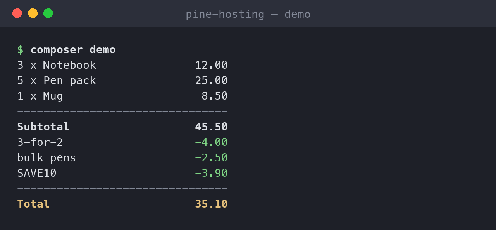
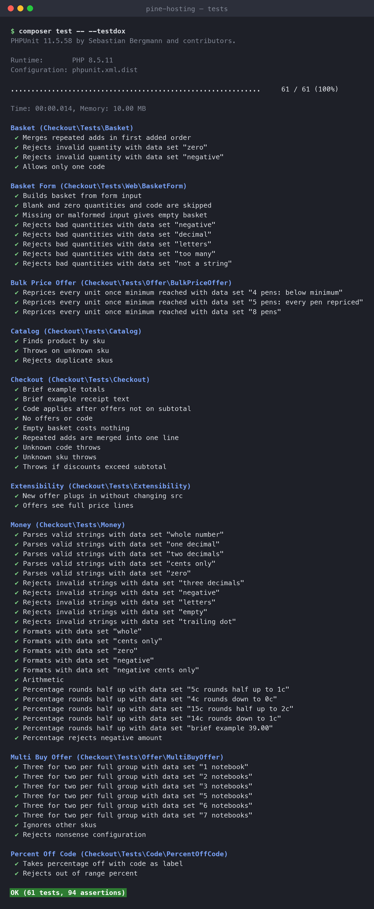

# Checkout pricing (Pine Hosting, task 2)

This is my solution to the checkout task. It prices a basket of items, applies the item offers and an optional discount code, and produces a receipt.

The core is a small PHP library with no framework. You can use it in three ways:

- **Web page.** Pick items in the browser and see the receipt.
- **Command line.** `composer demo` prints the example receipt from the brief.
- **Tests.** 61 PHPUnit tests cover the pricing rules.


## How to run the code and its tests

### 1. What you need

- **PHP 8.2 or newer.** Check with `php -v`.
- **Composer.** Check with `composer --version`.
- **Git**, to clone the repo.

No database, web server or PHP extensions are needed. PHP's built-in server is enough.

If you don't have PHP or Composer yet:

| OS | Install |
|---|---|
| macOS | `brew install php composer` (needs [Homebrew](https://brew.sh)) |
| Ubuntu / Debian | `sudo apt install php-cli php-xml php-mbstring unzip` then follow [getcomposer.org/download](https://getcomposer.org/download/) |
| Windows | Install PHP from [windows.php.net](https://windows.php.net/download/) and run the [Composer-Setup.exe](https://getcomposer.org/Composer-Setup.exe) installer |

`php-xml` and `php-mbstring` are only needed by the dev tools (PHPUnit, PHP CS Fixer), not by the checkout code itself.

### 2. Clone and install

```bash
git clone https://github.com/mohakamran/pine-hosting-checkout.git
cd pine-hosting-checkout
composer install
```

`composer install` downloads the dev tools into `vendor/` and sets up autoloading. Nothing else needs configuring.

### 3. Run it

**In the browser:**

```bash
composer serve
```

Open http://localhost:8000. Enter some quantities, optionally type `SAVE10`, and press **Price basket**. The "Load the example from the brief" link fills in 3 notebooks, 5 pen packs, 1 mug and `SAVE10`, which comes to 35.10. Press `Ctrl+C` in the terminal to stop the server.

**On the command line:**

```bash
composer demo
```



### 4. Run the tests and checks

```bash
composer test     # PHPUnit tests
composer check    # code style + PHPStan (level max) + tests, all in one
```

| Command | What it does |
|---|---|
| `composer test` | Runs the PHPUnit test suite |
| `composer check` | Code style, static analysis and tests in one go. This is what I run before every commit |
| `composer analyse` | PHPStan only |
| `composer cs` / `composer cs:fix` | Check / fix code style (PSR-12) |
| `composer demo` | Prints the brief's example receipt |
| `composer serve` | Starts the web page on http://localhost:8000 |

<details>
<summary>Test output (<code>composer test -- --testdox</code>)</summary>



</details>

### Troubleshooting

- **"vendor/autoload.php not found"**: run `composer install` first.
- **Port 8000 is already in use**: start the server on another port with `php -S localhost:8080 -t public`, then open http://localhost:8080.
- **"Your requirements could not be resolved"**: your PHP is older than 8.2. Check with `php -v`.
- **PHP CS Fixer warns about your PHP version**: this is only a notice when you run a newer PHP than 8.2. The check still passes.

## Design overview

The main idea is that `Checkout` doesn't know which offers exist. It's given a list of `Offer` objects and asks each one for its discounts. Adding a new kind of offer means writing a new class, not adding another `if` to the checkout.

| File | Responsibility |
|---|---|
| `src/Money.php` | Exact money amount stored as integer cents. Parsing, add/subtract/multiply, percentage with half-up rounding, formatting |
| `src/Product.php` | SKU, name and unit price |
| `src/Catalog.php` | Finds a product by SKU, lists all products, rejects duplicates, throws on unknown SKUs |
| `src/Basket.php` | What the customer is buying. Repeated SKUs are merged, and only one code is allowed |
| `src/PricedLine.php` | One basket line at full price (product, quantity, line total) |
| `src/Discount.php` | One discount line on the receipt (label and amount) |
| `src/Offer/Offer.php` | Interface for item offers: takes the priced lines, returns discounts |
| `src/Offer/MultiBuyOffer.php` | "Buy N, pay for M" per full group. Used for the notebook 3-for-2 |
| `src/Offer/BulkPriceOffer.php` | Lower unit price once you buy enough. Used for pens at 4.50 |
| `src/Code/DiscountCode.php` | Interface for discount codes |
| `src/Code/PercentOffCode.php` | Percentage off. Used for `SAVE10` |
| `src/Checkout.php` | Prices a basket: subtotal, then offers, then the code, then the total |
| `src/Receipt.php` | The result of pricing a basket |
| `src/ReceiptFormatter.php` | Turns a receipt into fixed-width text |
| `src/CheckoutFactory.php` | Sets up the catalog, offers and code from the brief |
| `src/Web/BasketForm.php` | Turns the web form's input into a `Basket`, validating quantities |
| `src/Exception/` | `UnknownSku`, `UnknownDiscountCode`, `CodeAlreadyApplied` |
| `public/index.php` | The web page |
| `bin/demo.php` | The command-line example |

### How the web page works

The page is deliberately thin. All the pricing happens in the same classes the tests cover.

1. The form sends the quantities and code as a normal GET request, for example `?qty[NB]=3&qty[PEN]=5&code=SAVE10`. Because it's GET, a priced basket is just a URL you can bookmark or share.
2. `BasketForm::toBasket()` reads that input and builds a `Basket`. Blank and zero quantities are skipped. Anything that isn't a whole number from 0 to 999 is rejected with a clear message.
3. `CheckoutFactory::default()->price($basket)` prices it, exactly as in the tests and the CLI demo.
4. The page renders the `Receipt` as a table. A collapsible section shows the same plain-text receipt as `composer demo`.
5. If something goes wrong, such as an unknown code or a bad quantity, the exception message is shown in place of the receipt. All output is HTML-escaped.

It uses no JavaScript and no frontend build step, just PHP and one inline stylesheet. It also follows your system's light or dark mode.

### Why integer cents

Floats can't store most decimal amounts exactly. For example, `0.1 + 0.2` isn't exactly `0.3`, so a float total can end up a cent out. I store every amount as a whole number of cents in an `int`, which keeps adding, subtracting and multiplying exact.

The only division is for percentages. It's done with integer maths, `intdiv($cents * $percent + 50, 100)`. The `+ 50` is half of 100, so anything at or above half a cent rounds up and anything below rounds down.

### How to add a new offer

1. Write a class that implements `Checkout\Offer\Offer`. It gets the priced lines and returns a `Discount` for each saving.
2. Add it to the offers list in `CheckoutFactory::default()`. Offers are applied, and shown on the receipt, in that order.
3. Write a test for it.

`Checkout` doesn't need to change. `tests/ExtensibilityTest.php` does exactly this with a "mug + tote bundle" offer defined inside the test. The new offer shows up on the web page and in the demo automatically.

## Assumptions

Where the brief left room for interpretation, I went with:

- Item offers stack with each other and with the discount code.
- 3-for-2 counts full groups of three, so 5 notebooks get 1 free and 6 get 2 free.
- Once you buy 5 or more pens, every pen is 4.50, not just the ones after the fifth.
- The pen line shows the full price, and the bulk saving appears as its own "bulk pens" discount line.
- `SAVE10` is 10% of the total after item offers, not of the subtotal.
- Codes are case-sensitive, so `save10` is rejected.
- An unknown SKU or code throws an exception instead of being silently ignored.
- Applying a second code to the same basket throws.
- Quantities must be whole numbers of 1 or more. The web form also caps them at 999.
- There's one currency, with two decimal places.

## What I would do next with more time

- Make `Money` currency-aware, so amounts in different currencies can't be mixed by accident.
- Add rules for how offers combine, for example "best offer wins" or offers that can't be combined.
- Load the catalog and offers from config instead of wiring them up in PHP.
- Support conditional codes, such as a minimum spend, an expiry date, or codes limited to certain products.
- Add property-based tests, for example "the total is never negative" over random baskets.
- Add a small CLI that takes a basket as arguments and prints the receipt.
