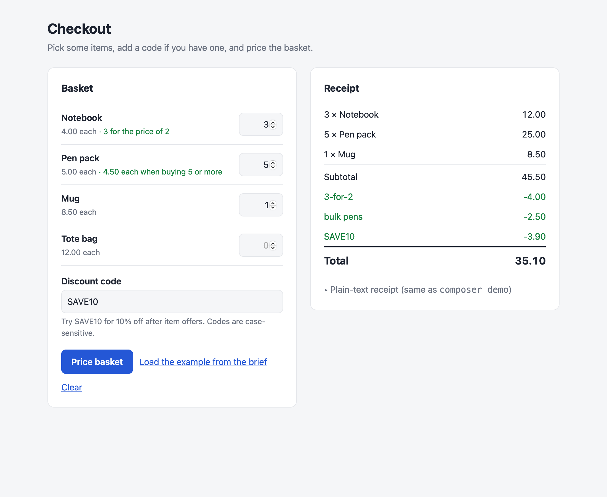

# Checkout pricing

My solution to the Pine Hosting checkout task. It prices a shopping basket, applies the offers and the `SAVE10` code, and shows a receipt. You can use it in the browser or from the command line.



## Install

You need PHP 8.2+ and Composer.

```bash
git clone https://github.com/mohakamran/pine-hosting-checkout.git
cd pine-hosting-checkout
composer install
```

## Run

```bash
composer serve   # web page at http://localhost:8000
composer demo    # prints the example receipt in the terminal
composer test    # runs the tests
composer check   # code style + static analysis + tests
```

If port 8000 is taken, use `php -S localhost:8080 -t public`.

## What I built

- Prices a basket using the products and offers from the brief: 3-for-2 notebooks, pens at 4.50 each when you buy 5 or more, and `SAVE10` for 10% off after the offers.
- Stores money as whole cents (integers), never floats, so every total is exact. Percentages round to the nearest cent, with halves rounding up.
- Gives each offer its own class, so a new offer can be added without changing the checkout code.
- Produces a receipt showing each item, each discount on its own line, and the total.
- Provides a simple web page and a command-line demo, both using the same pricing code.
- Includes 61 tests, plus PHPStan at its strictest level and a PSR-12 style check, all passing.

The brief's example (3 notebooks, 5 pen packs, 1 mug, `SAVE10`) comes to **35.10**:


